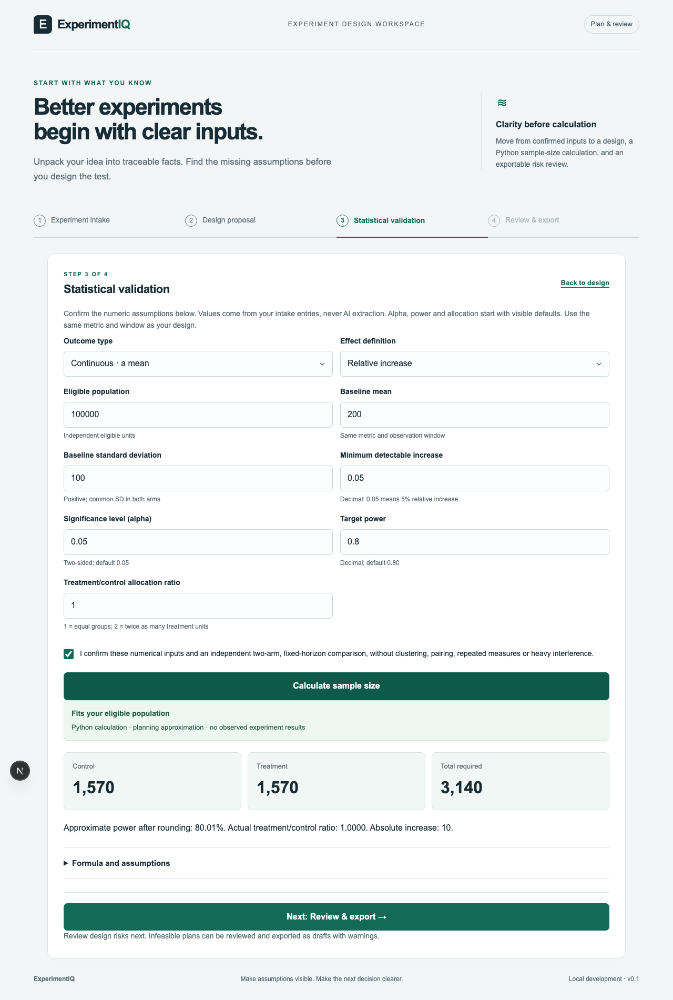

# ExperimentIQ

A planning workbench for Product Managers and Growth Analysts: turn a synthetic
experiment idea into traceable inputs, a proposed design, a Python sample-size
calculation, and an exportable risk review.

**The four-stage local workflow is implemented.** Public deployment and hosted CI
are separate release checks below. This is planning assistance, not observed
experiment results or approval to launch.

## Try the complete example

1. Click **Load complete synthetic example**, then **Extract experiment facts**.
2. Click **Next: Generate experiment design**. Review the draft and check its
   acknowledgement, then click **Next: Statistical validation**.
3. Review the numerical inputs, check their confirmation, and click **Calculate
   sample size**. The demo gives **1,570 control + 1,570 treatment = 3,140 total**.
4. Click **Next: Review & export**. Review the risks and unresolved assumptions,
   acknowledge them, then **Download Markdown report**.

Every Next button explains its requirements. Reached stages are clickable. Back
preserves unchanged work; editing intake clears later results, and changing
calculator inputs clears the calculation/review. There are no automatic approvals.

The complete preset uses fictional values: 100,000 eligible customers, mean spending
200 USD, SD 100 USD, 5% relative increase, alpha .05, power .80 and equal allocation.
The [copy-ready scenario](docs/complete-synthetic-example.md) explains the inputs.
Use **Load example with missing data** to demonstrate unknown baselines. Missing
inputs never produce a guessed sample size; conflicting intake values need correction.



Screenshots and the [two-minute walkthrough](output/demo/experimentiq-walkthrough.webm)
show provider-fixture UI responses with real Python calculations. They are explicitly
labelled; live OpenAI evaluation results are recorded separately.

## Local setup

Verified runtime targets: Python 3.13, Node 22, npm and Git. OpenAI credentials are
required for real extraction/design/critique; ordinary tests need no key.

```sh
python3 -m venv backend/.venv
backend/.venv/bin/python -m pip install -r backend/requirements.txt
test -f backend/.env || cp .env.example backend/.env
cd frontend
npm ci
test -f .env.local || cp .env.example .env.local
```

Set `OPENAI_API_KEY` in `backend/.env` locally. Never put it in the browser, frontend,
Git or chat. `OPENAI_MODEL` defaults to `gpt-4.1-mini`. Optional operator-supplied
input/output prices enable cost estimates; otherwise cost is null. Do not overwrite
existing environment files. Keep `PRODUCTION_MODE=false` for local development.

From the repository root, in separate terminals:

```sh
cd backend
.venv/bin/uvicorn app.main:app --reload --host 127.0.0.1 --port 8000 --no-access-log
```

```sh
cd frontend
npm run dev
```

Open [local UI](http://127.0.0.1:3000), [API health](http://127.0.0.1:8000/health), or
[API contracts](http://127.0.0.1:8000/docs). Health is liveness, not provider readiness.
Absent credentials produce an actionable error; production has no fake-success mode.

## Architecture and limits

```text
Next.js UI → FastAPI validation and quotas
           → OpenAI extraction → evidence/provenance checks
           → separate AI design proposal → explicit confirmation
           → deterministic Python sample-size calculation
           → independent AI critic + retained Python result
           → Markdown draft preview/download
```

Python owns validation, orchestration and statistics; TypeScript owns the UI.
Exact extraction quotes are evidence of source text, not proof of correct
interpretation. Extracted values remain unconfirmed. Calculator inputs come only
from explicit form entries and visibly confirmed defaults. Review recomputes all
numbers server-side and cannot accept an injected statistical result.

Supported statistics: independent two-arm, fixed-horizon, two-sided normal planning
approximations for continuous or binary outcomes; positive absolute/relative MDE;
unequal allocation. Unknown/unsupported inputs return null results. Clustering,
pairing, repeated measures, sequential stopping, multiple arms and substantial
interference need specialist methods. Rounded-allocation power is an approximation,
not exact power. Feasibility checks eligible units, not recruitment time or attrition.

[Specification](spec.md), [architecture decisions](docs/architecture.md),
[PRD](docs/prd.md), [increment evidence](docs/increment-3.md), and
[project guidance](agents.md) explain the boundaries. The original handoff is preserved.

## Verification

Run from the repository root:

```sh
backend/.venv/bin/ruff check backend evals
backend/.venv/bin/ruff format --check backend evals
backend/.venv/bin/python -m pytest -q backend
python3 scripts/check_secrets.py
cd frontend
npm run lint
npm run typecheck
npm run build
npx playwright install chromium
npm test
```

Verified locally: **123 backend tests, 14 browser tests**, lint, typechecking,
production build and secret pattern scan. Statistical tests compare independently
with Statsmodels for equal/unequal allocation. Shared quota tests execute the Lua
script and verify concurrency, daily caps, expiry, peer limits and fail-closed errors.

Browser tests start isolated servers on 3100/8100 and use `.next-e2e`. Only provider
HTTP is mocked in success scenarios; the frontend, FastAPI, SDK, schemas and
calculator run normally. Tests also intercept errors deliberately. Run build/type
checks before browser tests to avoid racing generated Next.js types.

The [CI workflow](.github/workflows/ci.yml) repeats checks without a key. A workflow
file or local pass is not proof of a successful hosted run. The secret scanner is
an offline pattern check, not a complete secret-detection product.

## Live evaluation

[Twenty synthetic cases and evaluator](evals/README.md) cover complete/incomplete
inputs, binary/continuous outcomes, biased selection, contamination, interference,
unsupported designs and prompt injection. The final `extract_v2` run completed
20/20 cases and 60/60 schema-validated stages. Annotated extraction and design-family
checks passed; keyword-based risk recall also passed. **Keyword recall is a proxy,
not human-validated methodological quality.** Development cases are not held out.
Median three-stage latency: 14.31 s; p95: 17.79 s. Cost is unestimated because token
prices were not configured. Earlier runs and annotation corrections are preserved.

```sh
backend/.venv/bin/python evals/run_evals.py --live --output evals/results/new-run.json
```

This command makes real, billable provider calls. No real customer data is used.

## Operations and free deployment

User-selected hosting scope: **free tiers only**. [Deployment runbook](docs/deployment.md)
covers Vercel Hobby, Render Free, and durable free Redis usage quotas. Hosting being
free does not make OpenAI calls free. Render's idle service may need to wake first.

Production startup requires HTTPS origins and shared Redis credentials. Quota
outages fail closed; default caps are 5 requests/peer/minute, 30 global/minute,
3 concurrent and 120 requests/day UTC. Requests have a 24 KiB body limit, bounded
input/output and retries, and 45-second AI stage deadlines. Untrusted forwarded
headers are ignored, which can conservatively share a peer budget behind proxies.
Logs contain request IDs, route/status/latency, error categories and available
usage metadata; they never intentionally contain objectives, credentials or raw
provider errors. No experiment-history database or real experiment execution.

## Assignment and next increments

Check marks below require observed evidence. Combined original rows are split so
completed work does not hide a remaining release step.

- [x] PRD with explicit unvalidated hypotheses
- [x] Technical specification, architecture notes, agent instructions, cursor rules
- [x] Extraction with validation, missing questions, provenance and conflicts
- [x] 123 backend tests and 14 browser tests; lint/typecheck/build pass locally
- [x] Local secret pattern check and metadata-only request logging
- [x] More than five meaningful local commits
- [x] Successful live synthetic extraction and design generation observed in the UI
- [x] Explicit design confirmation, visible Next buttons and back/edit flow
- [x] Independently tested binary/continuous sample-size engine
- [x] Critique, consistency checks and Markdown report/export
- [x] Twenty synthetic model evaluation cases and measured, qualified metrics
- [x] Competitor desk research with primary sources and evidence limits
- [ ] Original seven course validation steps — not pursued at the user's request;
      the supplied assignment brief still lists them. No claim of completion.
- [ ] Independent user/market validation — no interviews or demand evidence supplied
- [x] Public GitHub repository created: [experimentiq](https://github.com/calvinnguyen8k/experimentiq)
- [ ] Source/commit history pushed and successful hosted CI run verified
- [x] Production usage-protection implementation and tests; free-hosting configuration
- [ ] Production secrets/quotas configured and live deployment verified
- [ ] Full public/incognito workflow verified
- [x] README, screenshots and [two-minute labelled walkthrough](output/demo/experimentiq-walkthrough.webm)
- [x] [One-page reflection PDF](output/pdf/experimentiq-reflection.pdf), for owner review/personalization
- [ ] Accessible final deployment/demo links verified for submission
- [x] [GitHub v2 issue #1](https://github.com/calvinnguyen8k/experimentiq/issues/1) published

The [market evidence note](docs/market-evidence.md) distinguishes observed usability
feedback from market validation. No checklist item is checked solely to make the
assignment appear complete.
