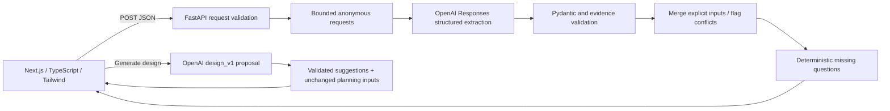

# Architecture and decisions

Revision 2 — 2026-11-23. Scope: local intake and design proposal.

1. **Python owns interpretation and validation.** FastAPI/Pydantic make contracts
   executable and keep future statistics beside orchestration. Next.js renders the
   workflow and never receives an API key. Browser JSON calls use an explicit CORS
   allowlist. Separate services preserve the handoff's Vercel/Python deployment path.
2. **Separate explicit stages, no agent framework.** Official async OpenAI SDK,
   `responses.parse(text_format=Extraction)`, `store=False`, a versioned prompt,
   bounded output, one transport retry, and one schema/evidence repair attempt.
   An overall deadline bounds the whole operation. No fake-success fallback.
   Extraction and design share a structured-call helper for identical error,
   retry, usage and timeout behavior. Each stage has its own schema and prompt.
   Design is a new user-triggered call, using validated form inputs and objective;
   no client-supplied extraction provenance is trusted. Missing baselines are
   retained as null in the separate immutable planning-input snapshot.
3. **Evidence is necessary but not semantic proof.** Each prose extraction carries
   an exact substring from the objective. Invalid quotes reject the response. An
   exact quote cannot prove the LLM interpreted it correctly, so all prose values
   remain `llm_extracted`, with `requires_confirmation=true`. Explicit optional form
   fields are `user_provided`. Future proposals are `llm_suggested`; mathematical
   transformations are `derived`. Future statistics accept confirmed inputs only.
4. **Structured values win without hiding conflicts.** A differing extraction is
   retained in a conflict record; numeric/type differences cause `needs_attention`.
   Primary-metric text differences are an informational wording note, since string
   inequality cannot establish a semantic contradiction. The explicit metric wins;
   we do not claim either equivalence or contradiction from wording alone.
   Missing questions are generated from field rules, not guessed by the model.
5. **Stateless, conservative local protection.** A 24 KiB body cap, per-client and
   global process rate limits, and a concurrent-call cap bound work. Client identity
   uses the socket peer, not spoofable forwarding headers. This is a single-process
   development baseline; a shared limiter, trusted proxy configuration, host budgets,
   and edge protection are deployment prerequisites, not claimed as finished.
6. **Privacy by construction.** No persistence. Logs include generated request IDs,
   route templates, latency, status/error category, validation counts, model,
   attempts, and usage when available; never raw inputs, responses, keys, or provider
   exception text. `store=False` does not promise zero provider retention.
   Cost is an explicitly labeled estimate only when operator-supplied token prices
   are configured; otherwise it is null. Failed provider calls may have unknown cost.
7. **Tests exercise boundaries.** Inject the extractor for API tests; separately test
   the official SDK adapter with an HTTP mock. Browser tests stub the backend only
   at the provider boundary using a separately launched, test-only API fixture.
   The production app has no mock mode.
8. **Model and dependencies.** Configurable `gpt-4.1-mini` initial default because
   its documented Responses/structured-output support suits bounded extraction.
   This is not a measured quality choice; account access and live behavior need a
   key-backed smoke test. Lock dependency resolutions for repeatable builds.
9. **Webpack for portable local builds.** Next.js's Turbopack CSS worker attempted
   a restricted port bind in this environment. Use the supported `--webpack` flag
   for development/build so the project does not depend on that worker behavior.
   `typecheck` generates Next.js types before running TypeScript; generated
   `next-env.d.ts` stays ignored, following the installed framework documentation.

## Deployment decision deferred

Vercel frontend and a separately selected Python host, HTTPS, frontend API URL set
at build time, backend secrets only, production origin allowlist. Do not publish
this increment as the complete MVP. Local health means process liveness, not OpenAI
readiness. No hosting account or public repository is created in this increment.

## Reference checks

Verified 2026-11-23 against official sources:
- [OpenAI quickstart](https://developers.openai.com/api/docs/quickstart)
- [Structured outputs and Python parsing](https://developers.openai.com/api/docs/guides/structured-outputs)
- [GPT-4.1 mini supported capabilities](https://developers.openai.com/api/docs/models/gpt-4.1-mini)

## Spec review

The complete synthetic preset is an explicit user-selected form preset, not a
fallback for missing data. It fills only intake inputs, never generated results;
submission still invokes OpenAI and every usual validation/provenance rule.
The incomplete example is retained to demonstrate missing-information behavior.

The initial handoff did not distinguish a quoted LLM extraction from a verified
fact. This revision adds mandatory confirmation, contradiction records, strict
payload limits, safe error envelopes, and a separate `extraction_complete` state
so completing intake never implies a completed statistical review.
