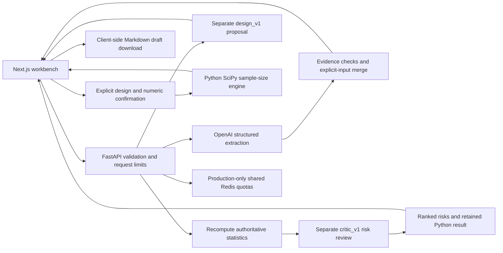

# Architecture and implementation decisions

Revision 3 — 2026-11-23. Four-stage local workflow; public deployment is tracked
separately in README. This document supersedes revision 2's planned-stage notes.

1. **Python owns domain logic and mathematics.** FastAPI/Pydantic validates every
   request; SciPy supplies normal quantiles and tail probabilities. TypeScript
   displays results and validates response shapes with Zod. A reviewer cannot
   overwrite calculator fields: the review request accepts inputs, not numbers
   claimed to be calculated. The backend recomputes and retains its own result.
2. **Explicit stages support correction.** Intake, design, statistics, and review
   have destination-labelled Next controls. Requirements explain disabled buttons.
   Reached stages are clickable. Back preserves work, while intake edits clear all
   later results. Calculator edits clear calculation/review and require renewed
   numerical confirmation. Reopening an unchanged result makes no provider call.
3. **Provenance remains separate.** Exact source quotes are required for non-null
   extracted facts, but do not establish semantic correctness. Prose remains
   `llm_extracted` and unconfirmed. Form entries are `user_provided`; proposals and
   critique are AI suggestions; Python outputs are `derived`. The statistical
   form starts only from explicit intake values plus visible alpha/power/ratio
   defaults. Nothing extracted or generated silently becomes a baseline.
4. **The calculator has narrow scope.** Independent, two-arm, fixed-horizon,
   two-sided normal approximations only. Continuous outcomes assume common SD;
   binary outcomes use pooled-null/unpooled-alternative variance. Relative and
   absolute positive MDEs are supported. Integer counts are rounded upward and
   power is checked again using the actual rounded allocation. A bounded upward
   correction handles rare rounding shortfalls. Missing, unsupported, or numerical
   limit cases return null numbers. Feasibility compares total analyzable units
   with the pool; it does not estimate recruitment duration or account for attrition.
   Tests compare against independently implemented Statsmodels calculations for
   equal and unequal allocation. Small-arm/sparse-count limitations stay visible.
5. **Critique is independent but not an authority.** A separate `critic_v1` call
   reviews design risks and cross-stage inconsistencies. It receives the Python
   result, cannot replace it, and cannot certify launch readiness. Backend checks
   also preserve infeasibility, approximation warnings, proposal questions and
   assumptions. Metric/family mismatches stop review before calling the provider.
   A user acknowledgement permits exporting a draft, including unresolved risks.
6. **Bounded AI calls share one adapter.** Official async OpenAI Responses parsing,
   strict schemas, versioned prompts, `store=False`, 2,500 output-token limit,
   one transport retry, and one schema/evidence repair. Overall stage deadline is
   45 seconds; UI deadline is 50 seconds. There is no production fixture mode.
   Browser tests launch an isolated fixture API and mock only provider HTTP.
7. **Public usage protection fails closed.** Development retains per-process
   limits. Production additionally requires HTTPS origins and a Redis REST URL
   and secret; otherwise startup fails. One atomic Lua script enforces shared
   sliding-minute global/peer limits, a UTC daily request cap (default 120), and
   expiring concurrency leases. Redis time avoids application clock drift; shared
   storage preserves limits across worker restarts. Redis outages reject new work.
   Socket peers are hashed; untrusted forwarded headers are ignored. Behind a
   proxy this can conservatively share a peer budget, reducing availability rather
   than trusting spoofed identities. Daily caps include all stages, including the
   calculator; retries within an AI stage remain separately bounded. This is a
   request cap, not a guarantee of zero OpenAI spend or a dollar budget.
8. **Privacy and monitoring.** No experiment-history database. Logs contain only
   request IDs, route templates, latency, error/validation categories and available
   usage/cost metadata. No objective, model prose, credential or raw exception is
   logged. Redis stores quota counters, hashed peers, and request IDs with TTLs.
   Client report generation escapes untrusted Markdown/HTML. Provider retention
   is governed by provider policy; `store=False` is not a zero-retention promise.
9. **Deployment remains free-tier only.** User chose free hosting: Vercel Hobby
   frontend, Render Free Python API, free durable Redis for quotas. Account access,
   secret entry, verified deployment URLs and incognito checks are release gates.
   Render can cold-start after inactivity; quotas fail closed on external outages.
   No paid plan, trial upgrade, card entry, or service purchase is authorized.
10. **Evaluation is evidence, not marketing.** Twenty synthetic cases exercise
    extraction, design family and critique. Real runs are saved with model/prompt
    metadata, failures, token counts and latency. Risk keyword recall is explicitly
    a proxy, not a human-validated risk-recall score. The initial run is preserved;
    revised annotations/wording are recorded so changes cannot be mistaken for a
    held-out improvement. No interviews or market-demand claims are invented.

## Dependency and build decisions

Python 3.13 and Node 22 are the verified runtime targets. Lockfile resolutions are
checked in. SciPy is runtime; Statsmodels, Fakeredis/Lua, pytest and Ruff support
verification (currently one requirements file for straightforward local/CI setup).
Redis-py is bounded below 8 because Fakeredis 2.40's wrapper introspection fails
with redis-py 8.2; the quota tests reproduce that integration need.
Next.js builds use Webpack to avoid restricted Turbopack worker port binding.
Browser tests use `.next-e2e`; run type generation/build before browser tests to
avoid racing generated files. No hosted CI success is inferred from local checks.

## Verified primary references

- [SciPy normal distribution](https://docs.scipy.org/doc/scipy/reference/generated/scipy.stats.norm.html)
- [Statsmodels two-proportion power](https://www.statsmodels.org/stable/generated/statsmodels.stats.proportion.power_proportions_2indep.html)
- [Statsmodels formula source](https://www.statsmodels.org/stable/_modules/statsmodels/stats/proportion.html)
- [OpenAI structured outputs](https://developers.openai.com/api/docs/guides/structured-outputs)
- [Upstash REST API](https://upstash.com/docs/redis/features/restapi)
- [Render free services](https://render.com/docs/free)
- [Render Python version selection](https://render.com/docs/python-version)
- [Vercel monorepo deployment](https://vercel.com/docs/monorepos)
